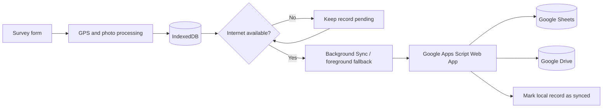

# MINI-PROJECT SHORT TECHNICAL REPORT

**Course:** Cross-Platform Mobile App Development (VKU)  
**Mini-Project Title:** Mini-Project 1 — Field Survey Progressive Web Application  
**Student Name:** Phạm Anh Quyền  
**Student ID:** 23IT.B181  
**Date of Birth:** 01/01/2005  
**Submission Date:** 12/10/2026

---

## 1. GENERAL INFORMATION & DELIVERABLE LINKS

### Student information

| Full name | Student ID | Role | Contribution |
|---|---|---|:---:|
| Phạm Anh Quyền | 23IT.B181 | Individual Developer — UI/UX, PWA Architecture, Offline Storage and Cloud Synchronization | 100% |

- **Application name:** Field Survey PWA (Ứng Dụng Điều Tra Hiện Trường)
- **Live Demo:** [https://quyen-jr.github.io/Field-Survey-pwa/](https://quyen-jr.github.io/Field-Survey-pwa/)
- **GitHub Repository:** [https://github.com/quyen-jr/Field-Survey-pwa](https://github.com/quyen-jr/Field-Survey-pwa)
- **Deployment platform:** GitHub Pages with GitHub Actions
- **Target platforms:** Android APK through Capacitor and installable PWA on modern mobile/desktop browsers

### Project overview

Field Survey PWA is a mobile-first application for interviewers and field investigators. It allows users to record interview information, obtain GPS coordinates, capture or select field photos, and save all collected data locally when an Internet connection is unavailable. When the device reconnects, pending records can be synchronized to Google Sheets while photos are uploaded to Google Drive through a Google Apps Script web endpoint.

---

## 2. FEATURE IMPLEMENTATION CHECKLIST

| # | Required Feature | Status | Implementation Details & Acceptance Level |
|:---:|---|:---:|---|
| 1 | Responsive mobile interface | ✅ Complete | Mobile-first layout with bottom navigation on phones and a sidebar layout on desktop. The interface adapts to different screen sizes and supports touch interaction. |
| 2 | Light and dark themes | ✅ Complete | A bright green visual system is used by default. Users can switch themes, and the selected theme is persisted locally. |
| 3 | Local offline persistence | ✅ Complete | Survey records, photos, settings and synchronization states are stored in IndexedDB through the `FieldSurveyDB` database. |
| 4 | Progressive Web App support | ✅ Complete | Includes a web app manifest, installable icons and a Cache-First Service Worker that caches the application shell and same-origin runtime assets. |
| 5 | GPS location capture | ✅ Complete | Uses the Geolocation API to obtain latitude, longitude and accuracy, and generates a Google Maps link for each record. |
| 6 | Camera and image processing | ✅ Complete | Supports direct camera capture and gallery selection. Images are resized and compressed on the client before storage and upload. |
| 7 | Survey form and history | ✅ Complete | Users can create records, browse history, view totals, filter by synchronization status, preview photos and delete local records. |
| 8 | Automatic cloud synchronization | ✅ Complete | Pending records are queued in IndexedDB. Background Sync drains the queue after reconnection even when the tab closes; `online` provides a compatibility fallback. Manual bulk and single-record sync are also available. |
| 9 | Google Sheets and Drive integration | ✅ Complete | Google Apps Script receives survey payloads, adds rows to Google Sheets and stores field images in Google Drive. |
| 10 | Notifications and user feedback | ✅ Complete | Uses in-app toast messages, Web Notifications, sound and vibration feedback for important operations. |
| 11 | Backup and local data management | ✅ Complete | Survey data can be exported as JSON. The settings screen also provides controlled local-storage cleanup. |
| 12 | Continuous deployment | ✅ Complete | Every push to the `main` branch triggers GitHub Actions to build the Vite project and deploy the `dist` artifact to GitHub Pages. |
| 13 | Capacitor Android wrapper | ✅ Complete | Includes the native Android project, Capacitor bridge, Camera and Geolocation plugins, plus a GitHub Actions workflow that builds a downloadable debug APK artifact. |

---

## 3. TECHNICAL ARCHITECTURE & PROJECT STRUCTURE

### Technology stack

- **Frontend:** HTML5, modern CSS, Vanilla JavaScript ES Modules and TypeScript-based Capacitor configuration
- **Build tool:** Vite 6
- **Local database:** IndexedDB
- **Offline runtime:** Service Worker and Cache API
- **Device APIs:** Geolocation, Camera/File Input, Canvas, Notifications, Web Audio and Vibration
- **Cloud backend:** Google Apps Script, Google Sheets and Google Drive
- **Deployment:** GitHub Actions and GitHub Pages
- **Native bridge:** Capacitor 7 with Android, Camera and Geolocation plugins

### Project structure

```text
Field-Survey-pwa/
├── .github/workflows/deploy.yml  # Automatic GitHub Pages deployment
├── .github/workflows/android.yml # Automatic Android debug APK build
├── android/                      # Native Android/Gradle project
├── capacitor.config.ts           # Capacitor application and plugin configuration
├── google-apps-script/Code.gs    # Google Sheets and Drive backend
├── public/
│   ├── icons/                    # PWA application icons
│   ├── manifest.json             # PWA metadata
│   └── sw.js                     # Offline cache Service Worker
├── src/
│   ├── camera.js                 # Image compression and formatting
│   ├── db.js                     # IndexedDB data-access layer
│   ├── geo.js                    # GPS location acquisition
│   ├── main.js                   # Application state, UI and event handling
│   ├── native.js                 # Capacitor runtime and native Camera adapter
│   ├── notify.js                 # Toast, sound, vibration and notifications
│   ├── style.css                 # Responsive light/dark design system
│   └── sync.js                   # Google Apps Script synchronization engine
├── index.html                    # Main application interface
├── package.json                  # Scripts and dependencies
└── vite.config.js                # Vite build configuration
```

### Data and synchronization flow



Each submitted survey is assigned a unique ID and initially saved with the `pending` synchronization state. Local storage occurs before any network operation, which protects data from unstable mobile connections. The synchronization engine reads pending records, sends them one by one to the configured Apps Script endpoint, saves returned Drive URLs and updates successful records to `synced`. Failed records remain pending and store an error message so the user can retry safely.

### State and exception handling

The application keeps the current GPS value, processed photo and active history filter in memory. Persistent survey data and user settings are handled asynchronously through IndexedDB. Operations that can fail—GPS access, image processing, database access, network requests and notification permission—are wrapped in `try/catch` blocks. Errors are presented through toast messages without discarding locally saved survey data.

---

## 4. EMPIRICAL EVIDENCE & SCREENSHOTS

The deployed application can be verified directly at the [live demo](https://quyen-jr.github.io/Field-Survey-pwa/). The following screens demonstrate the required functionality:

1. **New Survey screen:** responsive form containing interviewer name, live timestamp, GPS status, interview content, camera/gallery controls and the offline save action.
2. **Survey History screen:** total, synchronized and pending statistics; synchronization banner; status filters; record cards and individual actions.
3. **Settings screen:** Google Apps Script endpoint configuration, connection testing, setup instructions, JSON backup and local data controls.
4. **Responsive desktop view:** sidebar navigation, two-column form layout and bright visual design on a wide viewport.

> Before final submission, insert the four screenshots above into this section if image evidence is required by the lecturer. The application URL and repository already provide reproducible evidence of the implementation.

### Verification procedure

1. Open the live demo and allow location access.
2. Enter an interviewer name and survey content, then capture or choose a photo.
3. Disable the network and save the survey. Confirm that it appears with the **Pending** status.
4. Restore the network, configure the Apps Script URL and select **Sync Now**.
5. Confirm that the record changes to **Synced**, a row appears in Google Sheets and the photo link opens from Google Drive.

---

## 5. TECHNICAL CHALLENGES & RESOLUTIONS

### Challenge 1: Reliable data collection with unstable connectivity

Field investigators may lose their mobile connection while completing a survey. Sending data directly to the server could therefore cause data loss or duplicate submissions.

**Resolution:** The application follows an offline-first workflow. It always writes a complete record to IndexedDB before attempting synchronization. Each record has a unique ID and explicit synchronization state. Pending records remain available across page reloads and are retried when the network returns or when the user requests synchronization manually.

### Challenge 2: Storing and transferring large field photos

Original phone photos are often several megabytes, making IndexedDB storage and mobile uploads slow and expensive.

**Resolution:** Photos are decoded and resized with Canvas before being stored. The compression module limits image dimensions and applies JPEG compression while retaining sufficient field evidence. This reduces local storage use and the payload sent to Google Apps Script.

### Challenge 3: Providing an app-like experience across devices

The application must remain comfortable to use on small phones while also presenting information efficiently on desktop screens.

**Resolution:** CSS media queries provide two interaction patterns: a fixed bottom navigation bar and single-column controls on phones, and a sidebar with wider multi-column layouts on desktop. The web manifest and Service Worker make the project installable and allow the application shell to open offline.

---

## 6. CONCLUSION

The project satisfies the objectives of a cross-platform mobile mini-project by using one web codebase for an installable PWA and a Capacitor Android application. Its Cache-First architecture, IndexedDB queue, native Camera/GPS bridge and background cloud synchronization make it suitable for practical field data collection. Future improvements may include authentication, encrypted local data, conflict resolution and an administrator dashboard for aggregated survey analysis.

---

## 7. LOCAL INSTALLATION AND EXECUTION

```bash
git clone https://github.com/quyen-jr/Field-Survey-pwa.git
cd Field-Survey-pwa
npm install
npm run dev
```

Open `http://localhost:5173/` in a browser. A production build can be generated with `npm run build`.

For Android, install Android Studio/SDK and JDK 21, then run `npm run cap:sync` and `npm run android:open`. The repository's Android workflow also produces `VKU-Field-Survey-debug-apk` in GitHub Actions artifacts.
